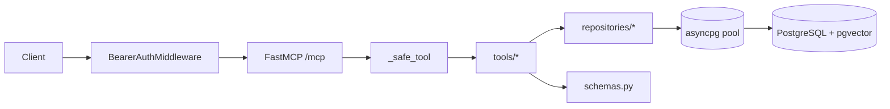

# Architecture

Entry point: `main.py:main` calls `app.server:create_server().run(transport="streamable-http")`; handles `KeyboardInterrupt` with exit 0.

Layers:
1. Transport/auth: `app/server.py:AuthenticatedFastMCP`, `BearerAuthMiddleware` (Starlette middleware).
2. Tools: `app/tools/*.py` validate input via pydantic models and call repositories with `get_pool()`.
3. Repositories: `app/repositories/*.py` hold SQL constants and run asyncpg queries.
4. Schemas/errors: `app/schemas.py`, `app/errors.py`.
5. Infra helpers: `app/config.py` (settings), `app/db.py` (global pool, vector literal).

Data flow: client -> HTTP `/mcp` -> bearer check -> FastMCP -> `_safe_tool` wrapper -> tool function -> schema validation -> repository -> asyncpg pool -> PostgreSQL -> pydantic result model.

Lifecycle: `server.lifespan` creates the pool at startup, closes it at shutdown.

Tests: `tests/` has test_config, test_customer_tools, test_db_helpers, test_recipe_tools, test_schemas, test_server_auth, test_workflow_tools (pytest, asyncio_mode=auto).

Sources: main.py, app/server.py, app/tools/*.py, app/repositories/*.py, pyproject.toml
Verified: 2026-11-05
